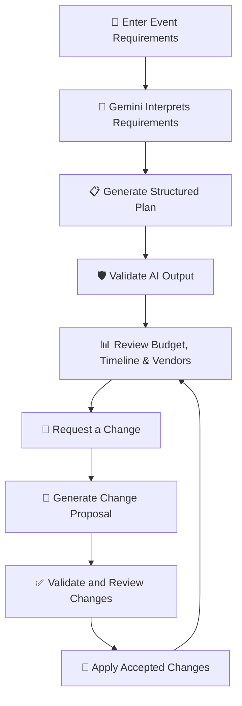
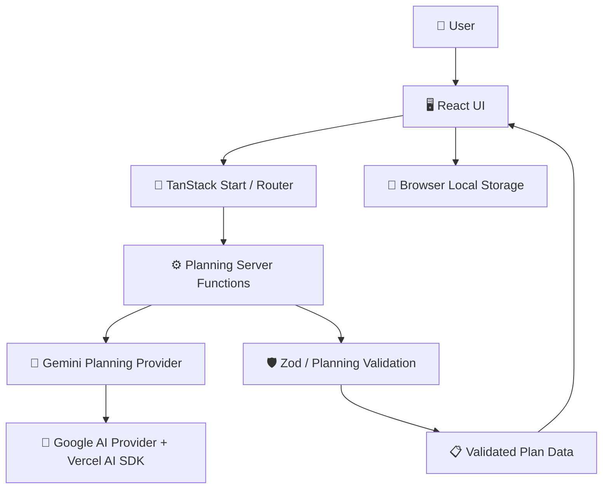

<div align="center">

# 🎉 EventPilot

### ✨ Plan smarter. Spend wiser. Celebrate better.

**Your AI-powered event planning companion.**

Plan weddings, birthdays, and community events with AI-assisted budgets, timelines, tasks, and vendor checklists—all in one workspace.

<br/>

[🚀 Get Started](#-get-started) · [✨ Features](#-key-features) · [🧠 How It Works](#-how-it-works) · [🛠️ Tech Stack](#️-technology-stack)

<br/>


</div>

---

## 📑 Table of Contents

- [🎯 The Problem](#-the-problem)
- [💡 The Solution](#-the-solution)
- [✨ Key Features](#-key-features)
- [🧠 How It Works](#-how-it-works)
- [🏗️ Architecture](#️-architecture)
- [🛠️ Technology Stack](#️-technology-stack)
- [🚀 Get Started](#-get-started)
- [🧪 Testing](#-testing)
- [💾 Data & Persistence](#-data--persistence)
- [🔐 Security](#-security)
- [⚠️ Current Limitations](#️-current-limitations)
- [🗺️ Project Structure](#️-project-structure)

---

## 🎯 The Problem

Planning an event is exciting. Managing everything behind it? Not so much. 💀

Event organizers often need to juggle:

- 💰 Budgets that must not spiral out of control.
- 📅 Deadlines, dependencies, and last-minute changes.
- 🏢 Vendors, quotations, and outstanding arrangements.
- 🔄 Changing requirements without losing track of the original plan.

For first-time and budget-conscious organizers, keeping everything coordinated can quickly become overwhelming.

## 💡 The Solution

**EventPilot brings event planning into one AI-assisted workspace.**

Instead of starting from scratch every time something changes, users can generate a structured plan, review its details, and request changes using everyday language.

> 💬 _"Increase the guest count to 150, reduce the budget to ₹85,000, and move the event two weeks earlier."_

EventPilot's planning workflow can propose the requested changes while application-level validation helps maintain consistency and protect existing plan data.

### 👥 Who Is It For?

| 🎯 User                      | 💡 How EventPilot Helps                            |
| ---------------------------- | -------------------------------------------------- |
| 💍 Wedding organizers        | Coordinate arrangements, costs, and deadlines.     |
| 🎂 Birthday planners         | Organize activities and keep spending visible.     |
| 🎪 Community organizers      | Manage guest counts, logistics, and priorities.    |
| 💸 Budget-conscious planners | Understand estimated costs and potential overruns. |

---

## ✨ Key Features

<table>
<tr>
<td width="50%">

### 🤖 AI-Assisted Planning

Turn natural-language event requirements into a structured planning proposal.

</td>
<td width="50%">

### 💰 Budget Awareness

Organize planned expenses and review budget allocations and potential overruns.

</td>
</tr>
<tr>
<td width="50%">

### 📅 Timeline & Tasks

Keep planning tasks, priorities, deadlines, and statuses organized.

</td>
<td width="50%">

### 🏢 Vendor Checklist

Track vendor requirements and relevant planning information.

</td>
</tr>
<tr>
<td width="50%">

### 🔄 Natural-Language Updates

Request changes to an existing plan without restarting the entire planning process.

</td>
<td width="50%">

### 🛡️ Structured Validation

Validate AI-generated data against application schemas before it enters the planning workflow.

</td>
</tr>
</table>

---

## 🧠 How It Works



### 🔍 The Planning Workflow

1. 📝 **Describe the event** — provide details such as event type, guest count, date, location, and budget.
2. 🤖 **Generate a plan** — use Gemini to assist with interpreting requirements and creating structured planning data.
3. 📊 **Review the details** — inspect the event overview, budget, timeline, tasks, and vendor requirements.
4. 💬 **Request changes** — describe what needs to change in plain language.
5. 🛡️ **Validate the proposal** — check structured AI output against the application's schemas and planning rules.
6. 🎯 **Review and apply** — evaluate the proposed modifications and their consequences before applying them.

**The core principle:** AI helps propose; application logic validates. Important decisions remain in the user's hands.

---

## 🏗️ Architecture

EventPilot separates the user interface, planning workflow, state management, validation, and provider-specific AI integration.



### 🧩 Main Components

| Component         | Responsibility                                    |
| ----------------- | ------------------------------------------------- |
| `src/components/` | 🖥️ User-interface components                      |
| `src/routes/`     | 🧭 Application routes                             |
| `src/ai/`         | 🤖 AI provider integration and structured schemas |
| `src/lib/`        | ⚙️ Planning functions and application logic       |
| `src/state/`      | 💾 Workspace state and plan persistence           |

### 🤖 Gemini Integration

EventPilot uses Google's Gemini model through `@ai-sdk/google` and the Vercel AI SDK.

When you use AI planning, EventPilot sends your event description, the event details needed to create a plan, or relevant plan details and your change request to Google Gemini. The API key stays on the server. Your active plan is otherwise stored in this browser; avoid entering information you do not want sent to the AI service. Review Google's current terms and privacy information for its handling of AI requests.

The provider supports three primary planning operations:

- 📝 Extracting event details from natural language.
- 📋 Generating an initial event plan.
- 🔄 Proposing changes to an existing plan.

Structured model output is validated against application schemas. Invalid proposals should not be treated as accepted changes.

The default model is `gemini-3.1-flash-lite`, which can be overridden using an environment variable.

---

## 🛠️ Technology Stack

| Technology                 | Role                                     |
| -------------------------- | ---------------------------------------- |
| ⚛️ React 19                | User interface                           |
| 🔷 TypeScript              | Type-safe application development        |
| 🧭 TanStack Start & Router | Application framework and routing        |
| ⚡ Vite                    | Development server and production builds |
| 🎨 Tailwind CSS            | Styling                                  |
| 🤖 Google Gemini           | AI-assisted planning                     |
| 🔌 Vercel AI SDK           | Structured AI generation                 |
| 🛡️ Zod                     | Runtime data validation                  |
| 🧪 Vitest                  | Automated testing                        |
| 🥟 Bun                     | Package management and scripts           |

---

## 🚀 Get Started

Ready to run EventPilot locally? Let's go! 🔥

### 📋 Prerequisites

Before you begin, make sure you have:

- [Bun](https://bun.sh/) installed.
- A Google Gemini API key from [Google AI Studio](https://aistudio.google.com/).
- Git installed on your machine.

### 1️⃣ Clone the Repository

```bash
git clone https://github.com/AbdulWebAgency/gather-grace-gatherings.git
cd gather-grace-gatherings
```

### 2️⃣ Install Dependencies

```bash
bun install
```

### 3️⃣ Configure Your Environment 🔑

Create a `.env.local` file in the project root.

Add your API key:

```dotenv
GEMINI_API_KEY=your_gemini_api_key
```

The application also accepts `GOOGLE_GENERATIVE_AI_API_KEY` as an alternative API-key variable.

**Optional:** Configure the Gemini model:

```dotenv
GEMINI_MODEL=gemini-3.1-flash-lite
```

If `GEMINI_MODEL` is omitted, EventPilot uses `gemini-3.1-flash-lite`.

> 🔐 **Keep your API key private.** Never commit `.env.local`, share your key publicly, or expose credentials in client-side code. The repository's `.gitignore` excludes local environment files.

### 4️⃣ Start the Development Server 🚀

```bash
bun run dev
```

Open the local URL displayed in your terminal.

### 5️⃣ Build for Production 📦

```bash
bun run build
```

### 6️⃣ Preview the Production Build 🔎

```bash
bun run preview
```

<details>
<summary>🧰 <strong>Useful Development Commands</strong></summary>

| Command           | What It Does                   |
| ----------------- | ------------------------------ |
| `bun run dev`     | Starts the development server. |
| `bun run test`    | Runs the automated test suite. |
| `bun run lint`    | Runs ESLint.                   |
| `bun run build`   | Creates a production build.    |
| `bun run preview` | Previews the production build. |

</details>

---

## 🧪 Testing

Testing helps catch regressions as the application evolves. 🛡️

Run the automated tests:

```bash
bun run test
```

Run the lint checks:

```bash
bun run lint
```

Create a production build:

```bash
bun run build
```

> 💡 Run these checks before submitting changes. Existing repository warnings or lint issues should be distinguished from regressions introduced by new changes.

---

## 💾 Data & Persistence

EventPilot currently stores the active event plan in the browser's local storage.

| Behavior            | Details                                                               |
| ------------------- | --------------------------------------------------------------------- |
| 💾 Saving           | The active plan is saved in the current browser.                      |
| 🔄 Refreshing       | Saved plan data can persist across page refreshes.                    |
| 🌐 Multiple devices | Plans are not automatically synchronized between browsers or devices. |
| 🧹 Browser data     | Clearing relevant site data can remove the locally stored plan.       |

**Heads-up:** Local browser storage is not a cloud backup. Keep this limitation in mind when using the application.

---

## 🔐 Security & Reliability

EventPilot is designed around a few important principles:

- 🔑 Keep AI credentials on the server.
- 🛡️ Validate structured AI responses before using them.
- 🧮 Keep authoritative calculations in application logic where applicable.
- 🚫 Do not treat generated vendor information as independently verified.
- 💬 Communicate AI failures without silently replacing them with fake success responses.
- 👤 Keep users in control of important planning decisions.

AI-generated prices and suggestions are estimates or proposals unless independently verified.

### Planning Assumptions

- Budget amounts are planning estimates, not vendor quotations.
- Vendor names, prices, availability and bookings are not independently verified.
- Task deadlines are calculated from suggested lead times and the event date; adjust them to fit your actual arrangements.
- AI suggestions reflect the details and priorities you provide and may need correction.

---

## ⚠️ Current Limitations

Transparency matters. Here's what users should know:

- 💾 Event data is stored locally in the current browser rather than synchronized to an account.
- ☁️ Cross-device synchronization is not provided by the current persistence approach.
- 🏢 Vendor availability, bookings, and quotations are not automatically verified by the AI integration.
- 🌐 AI features depend on a valid API key, model access, and network availability.
- 🧠 AI-generated recommendations may require user review and correction.

These limitations should be considered when using EventPilot for real-world event planning.

---

## 🗺️ Project Structure

```text
gather-grace-gatherings/
├── src/
│   ├── ai/                 # 🤖 AI provider and schemas
│   ├── components/         # 🖥️ UI components
│   ├── lib/                # ⚙️ Planning logic and server functions
│   ├── routes/             # 🧭 Application routes
│   └── state/              # 💾 Workspace state and persistence
├── package.json            # 📦 Scripts and dependencies
├── bun.lock                # 🥟 Bun lockfile
├── vite.config.ts          # ⚡ Vite configuration
└── README.md               # 📖 Project documentation
```

---

<div align="center">

## 🎉 Plan With Confidence. Celebrate With Joy.

**EventPilot** combines AI-assisted planning with structured validation to help people turn event ideas into organized plans.

Built with ❤️ for **PromptWars Virtual Challenge 5**.

⭐ If you find the project interesting, consider starring the repository!

</div>
