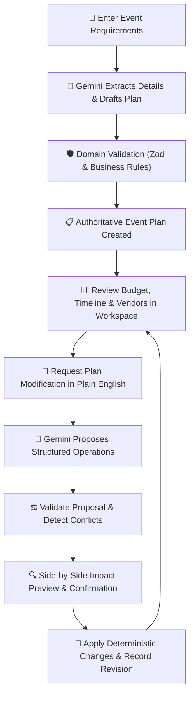
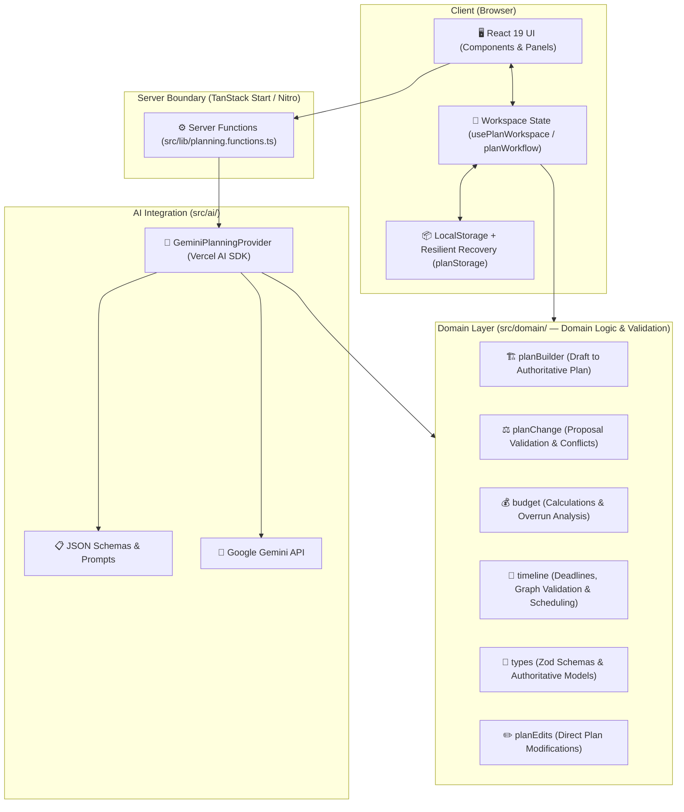

<div align="center">

# 🎉 EventPilot

### ✨ Plan smarter. Spend wiser. Celebrate better.

**Your AI-powered event planning companion.**

Plan weddings, birthdays, and community events with AI-assisted budgets, timelines, tasks, and vendor checklists—all in one workspace.

<br/>

[🚀 Get Started](#-get-started) · [✨ Features](#-key-features) · [🧠 How It Works](#-how-it-works) · [🛠️ Tech Stack](#️-technology-stack)

<br/>


</div>

---

## 📑 Table of Contents

- [🎯 The Problem](#-the-problem)
- [💡 The Solution](#-the-solution)
- [✨ Key Features](#-key-features)
- [🧠 How It Works](#-how-it-works)
- [🏗️ Architecture](#️-architecture)
- [🛠️ Technology Stack](#️-technology-stack)
- [🚀 Get Started](#-get-started)
- [🧪 Testing & Type-Checking](#-testing--type-checking)
- [💾 Data & Persistence](#-data--persistence)
- [🔐 Security & Reliability](#-security--reliability)
- [⚠️ Limitations & Booking Scope](#️-limitations--booking-scope)
- [🗺️ Project Structure](#️-project-structure)

---

## 🎯 The Problem

Planning an event is exciting. Managing everything behind it? Not so much. 💀

Event organizers often need to juggle:

- 💰 Budgets that must not spiral out of control.
- 📅 Deadlines, dependencies, and last-minute changes.
- 🏢 Vendors, quotations, and outstanding arrangements.
- 🔄 Changing requirements without losing track of the original plan.

For first-time and budget-conscious organizers, keeping everything coordinated can quickly become overwhelming.

## 💡 The Solution

**EventPilot brings event planning into one AI-assisted workspace.**

Instead of starting from scratch every time something changes, users can generate a structured plan, review its details, and request changes using everyday language.

> 💬 _"Increase the guest count to 150, reduce the budget to ₹85,000, and move the event two weeks earlier."_

EventPilot's planning workflow proposes structured modifications while domain-level validation maintains schema integrity, enforces dependency rules, prevents conflicting operations, and keeps calculations deterministic.

### 👥 Who Is It For?

| 🎯 User                      | 💡 How EventPilot Helps                            |
| ---------------------------- | -------------------------------------------------- |
| 💍 Wedding organizers        | Coordinate arrangements, costs, and deadlines.     |
| 🎂 Birthday planners         | Organize activities and keep spending visible.     |
| 🎪 Community organizers      | Manage guest counts, logistics, and priorities.    |
| 💸 Budget-conscious planners | Understand estimated costs and potential overruns. |

---

## ✨ Key Features

<table>
<tr>
<td width="50%">

### 🤖 AI-Assisted Planning

Turn natural-language event requirements into structured, editable event proposals.

</td>
<td width="50%">

### 💰 Budget Engine & Overrun Analysis

Track estimates versus recorded vendor quotes, auto-scale per-guest items, and analyze budget overruns.

</td>
</tr>
<tr>
<td width="50%">

### 📅 Timeline & Task Rescheduling

Calculate task deadlines from lead times, detect dependency cycles, and reschedule tasks when dates move.

</td>
<td width="50%">

### 🏢 Vendor Checklist

Track quotes, questions, notes, and booking statuses for vendor categories in a unified checklist.

</td>
</tr>
<tr>
<td width="50%">

### 🔄 Controlled Change Proposals

Request changes in plain English; review side-by-side impact previews with mandatory confirmations for sensitive operations.

</td>
<td width="50%">

### 🛡️ Domain Validation & Integrity

Validate plans against Zod schemas, enforce unique task IDs and keys, detect conflicting operations, and reject malformed AI outputs.

</td>
</tr>
</table>

---

## 🧠 How It Works



### 🔍 The Planning Workflow

1. 📝 **Describe the event** — provide details such as event name, category, guest count, date, location, and budget.
2. 🤖 **Generate initial draft** — Google Gemini extracts structured details and proposes initial budget items, tasks, and vendor requirements.
3. 🛡️ **Build authoritative plan** — Domain logic (`src/domain/planBuilder.ts`) validates draft schemas, enforces unique task keys and IDs, validates dependency graphs for cycles, computes deadlines, and generates stable IDs.
4. 📊 **Review in workspace** — inspect event details, interactive budget summaries, timelines, and vendor requirements.
5. 💬 **Request modifications** — ask for revisions in everyday language (e.g. adjust guest count, reallocate budget, change dates).
6. ⚖️ **Conflict detection & preview** — Domain logic (`src/domain/planChange.ts`) rejects conflicting operations (e.g., removing and updating the same item in any order), requires confirmations for major changes, and computes deterministic impacts.
7. 🎯 **Commit revision** — accepted changes increment the revision number, record explainable audit history, and update local persistence.

**The core principle:** AI proposes; domain logic validates and applies. All authoritative state mutations and calculations remain strictly deterministic.

---

## 🏗️ Architecture

EventPilot follows a layered architecture separating user interface, client workspace state, server RPC boundaries, AI provider integrations, and an isolated domain layer.



### 🧩 Main Modules & Responsibilities

| Module | Responsibility |
| --- | --- |
| `src/domain/` | 🧠 **Core Business Logic & Validation**<br/>• `types.ts`: Authoritative Zod schemas (`eventPlanSchema`, `budgetItemSchema`, `taskSchema`, etc.) and domain types.<br/>• `planBuilder.ts`: Converts AI drafts into authoritative plans, assigns IDs, enforces unique task keys/IDs, and checks for dependency cycles.<br/>• `planChange.ts`: Validates proposals, enforces conflict rules (order-independent removal vs. update conflicts, duplicate operations), and deterministically applies changes.<br/>• `budget.ts`: Computes totals, remaining balances, overrun contributions, and scales per-guest vs. fixed items.<br/>• `timeline.ts`: Calculates deadlines from lead times, shifts schedules, and detects dependency issues (cycles, self-dependencies, missing tasks).<br/>• `planEdits.ts`: Handles direct manual edits to budget items, tasks, event details, and quotes. |
| `src/state/` | 💾 **Workspace State & Persistence**<br/>• `planStorage.ts`: Browser `localStorage` persistence with corrupt-data isolation and backup preservation in a dedicated recovery slot.<br/>• `planWorkflow.ts`: Manages draft creation, proposal review lifecycle, stale proposal protection, and discarded review immutability.<br/>• `usePlanWorkspace.ts`: React hook coordinating active panels, direct editing, proposal review dialogs, and recovery triggers. |
| `src/lib/` | ⚙️ **Server Functions & Application Utilities**<br/>• `planning.functions.ts`: TanStack Start server RPC endpoints (`extractEventDetails`, `generatePlanDraft`, `proposePlanChange`).<br/>• `error-capture.ts`, `error-page.ts`, `lovable-error-reporting.ts`: Error capture boundaries and diagnostics.<br/>• `utils.ts`: Tailwind class merging utility (`cn`). |
| `src/ai/` | 🤖 **AI Integration Layer**<br/>• `geminiProvider.server.ts`: Google Gemini implementation using `@ai-sdk/google` and Vercel AI SDK `generateObject`.<br/>• `jsonSchemas.ts`: Strict JSON Schema definitions for structured model output.<br/>• `prompts.ts`: Prompt templates, input serialization, and user-content escaping.<br/>• `provider.ts`: `PlanningAIProvider` interface and typed `AIProviderError` error classes. |
| `src/components/` | 🖥️ **User Interface**<br/>• `workspace/`: Panels for Overview, Budget, Timeline, Vendors, History, Assistant, and Change Review.<br/>• `onboarding/`: Event intake form & wizard.<br/>• `ui/`: Radix UI accessible component primitives. |
| `src/routes/` | 🧭 **TanStack Router Pages**<br/>• `index.tsx`: Main entry point hosting the onboarding and active workspace views.<br/>• `__root.tsx`: Root application layout and document wrapper. |
| `src/test/` | 🧪 **Test Support**<br/>• `fixtures.ts`: Valid sample event plans, operations, and proposal builders for tests.<br/>• `setup.ts`: Vitest test setup and environment configuration.<br/>• `app-routing.test.tsx`: Route rendering and fallback tests. |

---

## 🛠️ Technology Stack

| Technology                 | Role                                     |
| -------------------------- | ---------------------------------------- |
| ⚛️ React 19                | User interface                           |
| 🔷 TypeScript 5.8          | Type-safe domain models and application  |
| 🧭 TanStack Start & Router | Full-stack SSR framework & file-based routing |
| ⚡ Vite 8                  | Development server & production bundler  |
| 🎨 Tailwind CSS 4          | Styling and responsive design            |
| 🤖 Google Gemini           | AI-assisted planning (`gemini-3.1-flash-lite`) |
| 🔌 Vercel AI SDK           | Structured AI output generation          |
| 🛡️ Zod 3                   | Runtime validation & schema enforcement  |
| 🧪 Vitest 4                | Unit & integration testing               |
| 🥟 Bun / Node.js & npm     | Package management & script execution    |

---

## 🚀 Get Started

### 📋 Prerequisites

- **Node.js** (v20+) or **Bun** installed.
- A **Google Gemini API key** from [Google AI Studio](https://aistudio.google.com/).
- Git.

### 1️⃣ Clone the Repository

```bash
git clone https://github.com/AbdulWebAgency/gather-grace-gatherings.git
cd gather-grace-gatherings
```

### 2️⃣ Install Dependencies

Using npm:
```bash
npm install
```

Or using Bun:
```bash
bun install
```

### 3️⃣ Configure Environment Variables 🔑

Create a `.env.local` file in the project root:

```dotenv
GEMINI_API_KEY=your_gemini_api_key
```

**Configuration Options:**

| Variable | Required | Default | Description |
| --- | --- | --- | --- |
| `GEMINI_API_KEY` | Yes* | — | Primary API key for Google Gemini. |
| `GOOGLE_GENERATIVE_AI_API_KEY` | Optional | — | Fallback API key variable supported by `geminiProvider.server.ts`. |
| `GEMINI_MODEL` | Optional | `gemini-3.1-flash-lite` | Override Gemini model (e.g., `gemini-2.5-flash`). |

*\*Either `GEMINI_API_KEY` or `GOOGLE_GENERATIVE_AI_API_KEY` must be provided.*

> 🔐 **Security Note:** API keys are read exclusively on the server in `src/ai/geminiProvider.server.ts` and never sent to the client browser. Local environment files (`.env.local`) are excluded by `.gitignore`.

### 4️⃣ Start the Development Server 🚀

```bash
npm run dev
# or: bun run dev
```

Open the local address printed by Vite (typically `http://localhost:3000`).

### 5️⃣ Build & Preview for Production 📦

```bash
npm run build
npm run preview
# or with bun:
# bun run build
# bun run preview
```

---

## 🧪 Testing & Type-Checking

The test suite covers domain logic, budget calculations, timeline constraints, proposal validation, storage resilience, and UI review safeguards.

### Run Automated Tests

```bash
npm test
# or: bun run test
```

Run tests in watch mode:
```bash
npm run test:watch
```

### Run TypeScript Type Check

Type-check the entire codebase using the project tsconfig:

```bash
npx tsc --noEmit -p tsconfig.json
# or: bunx tsc --noEmit -p tsconfig.json
```

### Run Linter

```bash
npm run lint
# or: bun run lint
```

### Available Scripts Summary

| Command | Action |
| --- | --- |
| `npm run dev` | Starts Vite development server with SSR support. |
| `npm test` | Runs Vitest test suite once across all test files. |
| `npm run test:watch` | Runs Vitest in interactive watch mode. |
| `npx tsc --noEmit -p tsconfig.json` | Runs TypeScript compiler checks without emitting files. |
| `npm run lint` | Runs ESLint across project files. |
| `npm run build` | Runs production build (Vite client + SSR + Nitro bundle). |
| `npm run preview` | Previews the production build locally. |

---

## 💾 Data & Persistence

EventPilot uses client-side browser storage designed with data resilience safeguards:

| Behavior | How It Works |
| --- | --- |
| 💾 **Primary Storage** | Active plans are stored in `localStorage` under `event-planner.plan.v1`. |
| 🛡️ **Recovery Isolation** | If data fails validation (e.g., from an incompatible schema version or corrupt JSON), it is moved to `event-planner.plan.v1.recovery` rather than being deleted. |
| 🔄 **Restore Dialog** | When valid recoverable data is detected, the UI displays a recovery banner allowing users to inspect and restore their previous plan. |
| 💾 **Pre-Recovery Backup** | Before applying a recovered plan, the current plan is backed up to `event-planner.plan.v1.pre-recovery` to prevent accidental loss. |
| 🌐 **Scope** | Storage is local to the current browser profile; plans do not automatically synchronize across devices or private browsing sessions. |

---

## 🔐 Security & Reliability

EventPilot applies specific architectural safeguards to ensure dependable planning:

1. 🔑 **Server-Only Credentials:** Gemini API keys are read in server-side functions and never bundled into client assets.
2. 🛡️ **Zero Direct AI Mutation:** The AI cannot directly overwrite plan records. It produces a proposal of discrete operations (`NormalizedOperation`), which are validated by `validateProposal` before presentation to the user.
3. ⚔️ **Order-Independent Conflict Rejection:** Operations targeting the same entity (e.g., updating an amount and removing the item) are rejected as conflicts regardless of their order in the proposal.
4. 🧮 **Deterministic Calculations:** All financial calculations, deadline adjustments, and scaling are computed by domain functions, never entrusted to LLM arithmetic.
5. ⚠️ **Mandatory User Confirmation:** Consequential operations—such as reducing budgets by more than 50%, setting items to ₹0, marking items as booked, or modifying confirmed costs—require explicit checkbox confirmation in the Change Review UI.

---

## ⚠️ Limitations & Booking Scope

Transparency is critical for competitive evaluation and real-world planning:

- 🏢 **No Direct Vendor Booking:** Booking statuses (`not_contacted`, `contacted`, `quote_received`, `booked`) are a **personal checklist and tracking tool**. EventPilot does not integrate with external vendor booking APIs, verify live calendar availability, or process monetary transactions.
- 💰 **Planning Estimates vs. Actual Quotes:** AI-suggested costs are planning baselines. Users must obtain and record actual vendor quotes to confirm pricing.
- ☁️ **No Cloud Synchronization:** Persistence is local to the browser. Clearing browser site data will remove the stored plan unless exported or backed up.
- 🌐 **AI Dependency:** AI drafting and natural-language modification require an active network connection, a valid Gemini API key, and sufficient API quota.
- 🧠 **User Oversight:** AI-generated timelines and checklists should be reviewed against actual local venue and vendor constraints.

---

## 🗺️ Project Structure

```text
gather-grace-gatherings/
├── src/
│   ├── ai/                 # 🤖 AI provider integrations, JSON schemas & prompt builders
│   │   ├── geminiProvider.server.ts # Google Gemini implementation via Vercel AI SDK
│   │   ├── jsonSchemas.ts           # Schema definitions for structured AI output
│   │   ├── prompts.ts               # Prompt templates & user input escaping
│   │   └── provider.ts              # PlanningAIProvider interface & AIProviderError
│   ├── components/         # 🖥️ React UI components
│   │   ├── common/                  # Shared badges, selectors, etc.
│   │   ├── onboarding/              # Event intake form & wizard
│   │   ├── ui/                      # Radix UI accessible primitives
│   │   └── workspace/               # Workspace panels (Budget, Timeline, Vendors, Review)
│   ├── domain/             # 🧠 Domain models, calculations & validation rules
│   │   ├── budget.ts                # Budget calculations, overruns & cost scaling
│   │   ├── ids.ts                   # Prefixed ID generation & currency rounding
│   │   ├── planBuilder.ts           # Draft validation, task key/ID uniqueness & plan build
│   │   ├── planChange.ts            # Proposal validation, conflict detection & change application
│   │   ├── planEdits.ts             # Direct manual mutations for plan entities
│   │   ├── timeline.ts              # Deadlines, dependency graph validation & rescheduling
│   │   └── types.ts                 # Authoritative Zod schemas & TypeScript types
│   ├── hooks/              # 🪝 React hooks (e.g. use-mobile)
│   ├── lib/                # ⚙️ Server RPC functions & infrastructure utilities
│   │   ├── error-capture.ts         # Runtime error boundaries
│   │   ├── planning.functions.ts    # TanStack Start server RPC endpoints
│   │   └── utils.ts                 # ClassName styling helper (clsx + tailwind-merge)
│   ├── routes/             # 🧭 TanStack Router file-based route definitions
│   │   ├── __root.tsx               # Root application layout
│   │   └── index.tsx                # Main planning workspace route
│   ├── state/              # 💾 Client workspace state & persistence
│   │   ├── planStorage.ts           # LocalStorage engine with resilient recovery
│   │   ├── planWorkflow.ts          # Proposal review lifecycle & safeguard state
│   │   └── usePlanWorkspace.ts      # Workspace coordinator hook
│   ├── test/               # 🧪 Shared test fixtures, setups & routing tests
│   │   ├── fixtures.ts              # Deterministic event plan & operation test fixtures
│   │   └── setup.ts                 # Vitest test setup
│   ├── router.tsx          # TanStack Router configuration
│   └── server.ts           # TanStack Start server entry
├── package.json            # 📦 Dependencies and package scripts
├── tsconfig.json           # 🔷 TypeScript compiler configuration
├── vite.config.ts          # ⚡ Vite & TanStack Start build configuration
├── vitest.config.ts        # 🧪 Vitest test configuration
└── README.md               # 📖 Project documentation
```

---

<div align="center">

## 🎉 Plan With Confidence. Celebrate With Joy.

**EventPilot** combines AI-assisted planning with structured domain validation to help people turn event ideas into organized, reliable plans.

Built with ❤️ for **PromptWars Virtual Challenge 5**.

⭐ If you find the project interesting, consider starring the repository!

</div>
